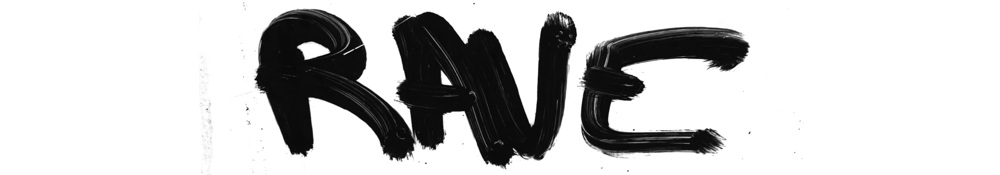
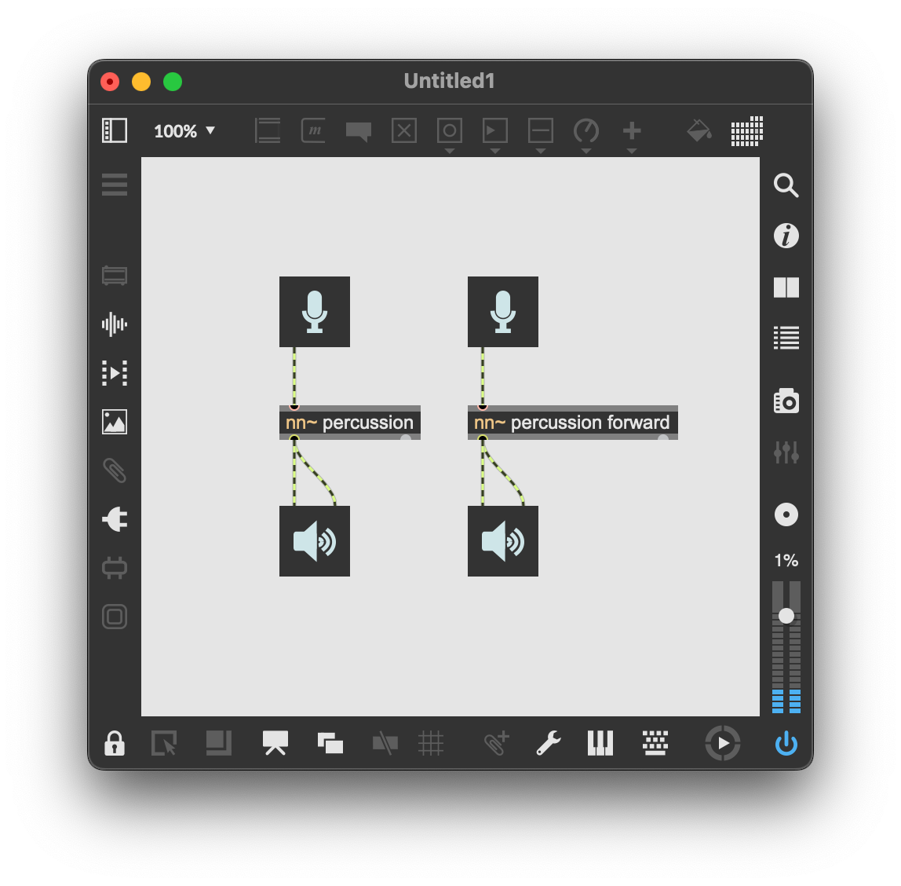

> [!WARNING]
> **This is a beta version of RAVE (v2.4).** Features and APIs may change before the stable release. See [what's new](https://acids-rave.readthedocs.io/en/latest/whats_new) for details on the changes in this version.



# RAVE: Realtime Audio Variational autoEncoder

Official implementation of _RAVE: A variational autoencoder for fast and high-quality neural audio synthesis_ ([article link](https://arxiv.org/abs/2111.05011)) by Antoine Caillon and Philippe Esling.

If you use RAVE as a part of a music performance or installation, be sure to cite either this repository or the article !

If you want to share / discuss / ask things about RAVE you can do so in our [discord server](https://discord.gg/abKp6t9jWY)!

Please check the FAQ before posting an issue!

**Documentation** : the full documentation (tutorials, command-line reference, configurations, Python API) is available at [acids-rave.readthedocs.io](https://acids-rave.readthedocs.io/en/latest/). Coming from RAVE 2.3? Read [what's new in 2.4](https://acids-rave.readthedocs.io/en/latest/whats_new) and its migration table.

**RAVE VST** RAVE VST for Windows, Mac and Linux is available as beta on the [corresponding Forum IRCAM webpage](https://forum.ircam.fr/projects/detail/rave-vst/). For problems, please write an issue here or [on the Forum IRCAM discussion page](https://discussion.forum.ircam.fr/c/rave-vst/651).

**Tutorials** : tutorials are available in the [documentation](https://acids-rave.readthedocs.io/en/latest/) and on the Forum IRCAM webpage:

- [Tutorial: Neural Synthesis in a DAW with RAVE](https://forum.ircam.fr/article/detail/neural-synthesis-in-a-daw-with-rave/)
- [Tutorial: Neural Synthesis in Max 8 with RAVE](https://forum.ircam.fr/article/detail/tutorial-neural-synthesis-in-max-8-with-rave/)
- [Tutorial: Training RAVE models on custom data](https://forum.ircam.fr/article/detail/training-rave-models-on-custom-data/) (written for RAVE 2.3; some flags have changed, see [what's new](https://acids-rave.readthedocs.io/en/latest/whats_new))

## Previous versions

The original implementation of the RAVE model can be restored using

```bash
git checkout v1
```

## Installation

RAVE requires **Python ≥ 3.11**. It is strongly advised to install `torch` and `torchaudio` before `acids-rave`, so you can choose the build matching your hardware (CUDA, ROCm, CPU, Apple Silicon) on the [PyTorch website](https://pytorch.org/get-started/locally/).

```bash
pip install "torch>=2.5.1,<2.15" "torchaudio>=2.5.1,<2.15" torchcodec  # pick the right build for your platform on pytorch.org
pip install acids-rave
```

You may also need **ffmpeg** and **sox** on your computer. You can install them inside a conda environment with

```bash
conda install -c conda-forge ffmpeg sox
```

To use `rave train_after` ([AFTER](https://github.com/acids-ircam/AFTER) diffusion models), install the optional extra:

```bash
pip install "acids-rave[after]"
```

## Colab

Two notebooks let you train and fine-tune RAVE on Google Colab, including with a free account. Everything (runs, checkpoints, preprocessed datasets) is kept on your Google Drive. If Colab disconnects, run the notebook again and the training resumes from the latest checkpoint.

- Train a model: [](https://colab.research.google.com/github/acids-ircam/RAVE/blob/v2.4/notebooks/train_rave_colab.ipynb)
- Fine-tune a model: [](https://colab.research.google.com/github/acids-ircam/RAVE/blob/v2.4/notebooks/finetune_rave_colab.ipynb)

A community colab to train RAVEv2, written for an earlier version of RAVE, is also available thanks to [hexorcismos](https://github.com/moiseshorta): [](https://colab.research.google.com/drive/1ih-gv1iHEZNuGhHPvCHrleLNXvooQMvI?usp=sharing)

## Usage

Training a RAVE model usually involves 3 separate steps, namely _dataset preparation_, _training_ and _export_. All commands go through the `rave` entry point; run `rave <command> --helpfull` to list every flag, or see the [command-line reference](https://acids-rave.readthedocs.io/en/latest/reference/cli/).

| Command       | Purpose |
| ------------- | ------- |
| `preprocess`  | Turn a folder of audio files into a training dataset |
| `train`       | Train a RAVE model |
| `finetune`    | Continue training an existing model, possibly on new data / with frozen parts |
| `export`      | Script a trained model into a `.ts` file for `nn~`, the VST or Python |
| `generate`    | Process audio files offline with one or several models |
| `dimred`      | Add / remove / list custom latent projections |
| `train_prior` | Train an autoregressive prior on a model's latent space |
| `train_after` | Train an AFTER diffusion model on a RAVE latent space (optional dependency) |
| `uncompile`   | Turn an exported `.ts` back into a trainable checkpoint |
| `adapt`       | Fit a linear adapter between the latent spaces of two exported models |

### Dataset preparation

Since v2.4, RAVE uses the [acids-dataset](https://github.com/acids-ircam/acids-dataset) library for data pre-processing; check its github to access all the library's features. A shortcut is given for a direct use within `rave`:

```bash
rave preprocess --input_path /audio/folder --output_path /processed/path --channels 1
```

Audio files are resampled (`--sampling_rate`, default 44100) and cut into overlapping chunks of `2 × num_signal` samples (`--num_signal`, default 131072), so don't be surprised if the pre-processed folder is larger than your original data. You can select files with `--filter` / `--exclude` (wildcards), parse metadata from file paths with `--meta_regexp`, and compute extra features with `--feature`.

**Training on raw audio.** You can also skip preprocessing and give a plain folder of audio files to `--db_path` at training time: files are decoded and resampled on the fly. This is the quickest way to start; for long trainings, preprocessing is still faster.

### Training

After the dataset pre-processing, you can start training your RAVE model.

```bash
rave train --name give_a_name --db_path /processed/path --out_path /model/out --device cuda:0
```

The run is written to `<out_path>/<name>_<hash>`. Useful flags:

- `--device`: `auto` (default), `cpu`, `cuda`, `cuda:0`, `mps`... Repeat it (`--device cuda:0 --device cuda:1`) for multi-GPU training.
- `--channels N` (`0` = number of channels of the dataset), `--stereo`, `--midside` (trains in mid/side, the exported model still takes and returns L/R) or `--ambisonics` (for A-format recordings, trained in B-format).
- `--normalize none|each|dataset|dataset_compress`: input normalization strategy.
- `--one_batch_per_file`: balances datasets with very uneven file lengths.
- `--beta`: target regularization weight (KL for variational models, MMD for Wasserstein models).
- `--resume path`: resume from a run folder, version folder or `.ckpt`. The configuration is read from the run.
- `--init_from path/to/run` (or `path/to/run->encoder,decoder`, or regular expressions on weight names): initialize some or all weights from another run.

Several configurations are available, that you can give using the `--config` keyword (default is `v2`). **Passing any `--config` replaces the default**, so always start the list with an architecture. For example, you can train a _discrete_ configuration, similar to SoundStream or EnCodec, by providing

```bash
rave train --config discrete ...
```

By default, RAVE is built with non-causal convolutions. If you want to make the model causal (hence lowering the overall latency of the model), you can use the causal mode

```bash
rave train --config v2 --config causal ...
```

Any value of the configuration can be changed with `--override`, e.g. `--override "CAPACITY=64"`.

Data augmentations are also available to improve the model's generalization, and are strongly recommended in low data regimes (less than about an hour of audio). They are provided by `acids-dataset` (with a link to [audiomentations](https://github.com/iver56/audiomentations)) and added with the `--augment` keyword:

```bash
rave train --config v2 --augment mute --augment compress --augment gain ...
```

Always use `mute`: without it the model never learns to output silence. Many more transforms are available (pitch shift, room simulation, EQ, distortion, noise...), see [data augmentations](https://acids-rave.readthedocs.io/en/latest/reference/configurations/#data-augmentations).

Many other configuration files are available in `rave/configs` and can be combined. Here is a list of the available configurations (see [configurations](https://acids-rave.readthedocs.io/en/latest/reference/configurations/) for details):

<table>
<thead>
<tr>
<th>Type</th>
<th>Name</th>
<th>Description</th>
</tr>
</thead>
<tbody>

<tr>
<td rowspan=13>Architecture</td>
<td>v1</td>
<td>Original continuous model (minimum GPU memory : 8Go)</td>
</tr>

<tr>
<td>v2</td>
<td>(default) Improved continuous model (faster, higher quality) (minimum GPU memory : 16Go)</td>
</tr>

<tr>
<td>v2_small</td>
<td>v2 with a smaller receptive field, adapted adversarial training, and noise generator, adapted for timbre transfer for stationary signals (minimum GPU memory : 8Go)</td>
</tr>

<tr>
<td>v2_nopqmf</td>
<td>(experimental) v2 without pqmf in generator (more efficient for bending purposes) (minimum GPU memory : 16Go)</td>
</tr>

<tr>
<td>v2_nopqmf_small</td>
<td>(experimental) smaller variant of v2_nopqmf, with random compression augmentation</td>
</tr>

<tr>
<td>v2_with_augs</td>
<td>(experimental) v2 with mel-spectrogram encoder input and random compression augmentation</td>
</tr>

<tr>
<td>v3</td>
<td>v2 with Snake activation, descript discriminator and Adaptive Instance Normalization for real style transfer (minimum GPU memory : 32Go)</td>
</tr>

<tr>
<td>v4</td>
<td>(experimental, new in 2.4) spectrogram-domain model: 2D encoder / decoder on a complex STFT, no PQMF, streamable</td>
</tr>

<tr>
<td>discrete</td>
<td>Discrete model (similar to SoundStream or EnCodec) (minimum GPU memory : 18Go)</td>
</tr>

<tr>
<td>discrete_v3</td>
<td>discrete with Snake activations and descript discriminator</td>
</tr>

<tr>
<td>hybrid</td>
<td>v2 with mel-spectrogram encoder input and a GRU in the decoder</td>
</tr>

<tr>
<td>onnx</td>
<td>Noiseless v1 configuration for onnx usage (minimum GPU memory : 6Go)</td>
</tr>

<tr>
<td>raspberry</td>
<td>Lightweight configuration compatible with realtime RaspberryPi 4 inference (minimum GPU memory : 5Go)</td>
</tr>

<tr>
<td rowspan=3>Regularization (v2 family)</td>
<td>(none)</td>
<td>Variational Auto Encoder objective (ELBO)</td>
</tr>

<tr>
<td>wasserstein</td>
<td>Wasserstein Auto Encoder objective (MMD)</td>
</tr>

<tr>
<td>spherical</td>
<td>Spherical Auto Encoder objective</td>
</tr>

<tr>
<td rowspan=2>Discriminator</td>
<td>spectral_discriminator</td>
<td>Use the MultiScale discriminator from EnCodec.</td>
</tr>

<tr>
<td>descript_discriminator</td>
<td>Use the Descript Audio Codec discriminator.</td>
</tr>

<tr>
<td rowspan=7>Others</td>
<td>causal</td>
<td>Use causal convolutions</td>
</tr>

<tr>
<td>noise</td>
<td>Enables noise synthesizer V2</td>
</tr>

<tr>
<td>snake</td>
<td>Snake activations everywhere (better periodic signals)</td>
</tr>

<tr>
<td>adain</td>
<td>Adaptive Instance Normalization in encoder and decoder (style transfer; included in v3)</td>
</tr>

<tr>
<td>adv_at_start</td>
<td>Enables adversarial learning at start (Experimental). Can be added when resuming.</td>
</tr>

<tr>
<td>no_encoder_freeze</td>
<td>Does not freeze the encoder at phase 2 (latent space is still trained). Can be added when resuming.</td>
</tr>

<tr>
<td>normalize_ambient</td>
<td>Adds a compressor augmentation tuned for ambient material</td>
</tr>

</tbody>
</table>

### Export

Once trained, export your model to a torchscript file using

```bash
rave export --run /path/to/your/run --streaming (--name export_name --out_path /out/path/for/scripted)
```

Setting the `--streaming` flag will enable cached convolutions, making the model compatible with realtime processing. **If you forget to use the streaming mode and try to load the model in Max, you will hear clicking artifacts.**

Other useful flags:

- `--db_path /path/to/dataset`: recompute the latent PCA on a whole dataset with the final model (recommended; during training it is only estimated on validation batches). Required to get a PCA for Wasserstein models.
- `--fidelity 0.95`, `--latent_size N` or `--no_pca`: choose the exported latent size, or export the raw latent space.
- `--ica`, `--sfa`, `--pls`, `--cca`, `--mapper` (with `--db_path`): embed custom latent projections, switchable live in Max with the `projection` attribute.
- `--ckpt_name best.ckpt`: export another checkpoint than `last.ckpt`.

The exported file embeds the model's configuration, so it can be turned back into a trainable checkpoint with `rave uncompile --model my_model.ts`.

### Custom representations

`rave dimred` adds, removes or lists custom latent projections (`pca`, `wpca`, `ica`, `sfa`, `pls`, `cca`, `lda`) fitted on your own audio, on a run or directly on an exported `.ts`:

```bash
rave dimred add --model my_model.ts --name strings --audio /path/to/strings --type pca --type sfa
```

See the [custom representations tutorial](https://acids-rave.readthedocs.io/en/latest/tutorials/05_custom_representations/).

### Fine-tune

Since v2.4, `rave finetune` allows you to fine-tune a model from an existing run. The difference between fine-tuning and training is that you generally fine-tune on another dataset than the original training, starting with fresh optimizers, and freeze / train only some parts of the model. For example, fine-tuning only the encoder of a model trained on flute with a voice dataset improves timbre transfer from voice to flute:

```bash
rave finetune --name run_name --run /path/to/original/run --db_path /path/to/db --out_path /path/to/finetuned/model --mode encoder
```

`--mode` chooses the objective:

- `encoder` (default): update only the encoder with reconstruction and latent regularization losses; the decoder is fixed.
- `decoder`: update the decoder with reconstruction, adversarial and feature-matching losses; update the discriminator on separate batches at the configured cadence. The encoder is fixed.
- `full`: run decoder mode for the first half of `--max_steps`, then encoder mode for the second half. Default: 25,000 batches per phase. Set a positive even total with `--max_steps`.

`--train` and `--freeze` further restrict the trained weights, using either specific words (`all`, `encoder`, `decoder`, `discriminator`) or regular expressions on weight names. For example :

```bash
rave finetune --name run_name --run /path/to/original/run --db_path /path/to/db --mode decoder --train "decoder.net.[0-3].*"
```

will only fine-tune the first layers of the decoder. To access all the keys, you can use Python :

```python
import rave

model, path = rave.load_rave_checkpoint("path/to/run")
print(model.state_dict().keys())
```


Learning rates are set per module (`--lr_encoder`, `--lr_decoder`, `--lr_discriminator`).
`--encoder_start_step` delays updates in encoder mode; omit it for `full`.
`--beta` sets the variational encoder's KL weight (default: source beta divided by 4).
PCA updates are enabled by default; `--noupdate_pca` retains the source axes.
Use `--resume` with the same settings to restore optimizers, batch count and phase.
For `full`, retain `--max_steps` so the phase boundary stays unchanged.
See the [fine-tuning tutorial](https://acids-rave.readthedocs.io/en/latest/tutorials/07_finetune/) for details.

## Prior

For discrete models, we redirect the user to the `msprior` library [here](https://github.com/caillonantoine/msprior). However, as this library is still experimental, the prior from version 1.x has been re-integrated in v2.3.

### Training

To train a prior for a pretrained RAVE model :

```bash
rave train_prior --name my_prior --model /path/to/your/run --db_path /path/to/your_preprocessed_data --out_path /path/to/output
```

this will train a prior over the latent of the pretrained model `path/to/your/run`, and save the model and tensorboard logs to folder `/path/to/output`.

### Scripting

To script a prior along with a RAVE model, export your model by providing the `--prior` keyword to your pretrained prior :

```bash
rave export --run /path/to/your/run --prior /path/to/your/prior --fidelity 0.99 (--streaming)
```

The exported latent size must match the one of the prior: use the same `--fidelity` (or `--latent_size`) as for `train_prior` (whose default is `0.99`, while the export default is `0.95`).

## Pretrained models

Several pretrained streaming models [are available here](https://acids-ircam.github.io/rave_models_download). We'll keep the list updated with new models.

## Realtime usage

This section presents how RAVE can be loaded inside [`nn~`](https://acids-ircam.github.io/nn_tilde/) in order to be used live with Max/MSP or PureData.

### Reconstruction

A pretrained RAVE model named `darbouka.gin` available on your computer can be loaded inside `nn~` using the following syntax, where the default method is set to forward (i.e. encode then decode)



This does the same thing as the following patch, but slightly faster.


Since v2.4, `forward` goes through the full latent space (`decode_full(encode_full(x))`), giving the best reconstruction whatever the exported latent size. The `encode_full` / `decode_full` methods expose the raw latent space, and `encode_dist` returns the posterior mean and standard deviation.

### High-level manipulation

Having an explicit access to the latent representation yielded by RAVE allows us to interact with the representation using Max/MSP or PureData signal processing tools:


### Style transfer

By default, RAVE can be used as a style transfer tool, based on the large compression ratio of the model. We recently added a technique inspired from StyleGAN to include Adaptive Instance Normalization to the reconstruction process, effectively allowing to define _source_ and _target_ styles directly inside Max/MSP or PureData, using the attribute system of `nn~`.


Other attributes, such as `enable` or `gpu` can enable/disable computation, or use the gpu to speed up things (still experimental). New in 2.4:

- `projection`: active latent projection (`default` for PCA, `raw`, or any custom projection), switchable live with `set projection <name>`;
- `projection_names`: list of available projections;
- `temperature`: scales the posterior sampling and the noise used for latent dimensions not driven by `decode` (`0` = deterministic);
- `receptive_field`: receptive field of the model, in samples.

See [exported models](https://acids-rave.readthedocs.io/en/latest/reference/scripted_model/) for the complete reference.

## Offline usage

The `rave generate` script allows the transformation of large amounts of files

```bash
rave generate --model model_path --input path_1 --input path_2 --out_path out_path (--mode stream --mode full --device cuda:0)
```

where `model_path` is the path to your trained model (training run or exported `.ts`; several `--model` can be given), `path_X` a list of audio files or directories, and `out_path` the out directory of the generations. `--mode` selects streaming (`stream`, default) and/or whole-file (`full`) processing, and `--loudness` applies input gains in dB (several values give several outputs).

## Discussion

If you have questions, want to share your experience with RAVE or share musical pieces done with the model, you can use the [Discussion tab](https://github.com/acids-ircam/RAVE/discussions) !

## Demonstration

### RAVE x nn~

Demonstration of what you can do with RAVE and the nn~ external for maxmsp !

[](https://www.youtube.com/watch?v=dMZs04TzxUI)

### embedded RAVE

Using nn~ for puredata, RAVE can be used in realtime on embedded platforms !

[](https://www.youtube.com/watch?v=jAIRf4nGgYI)

# Frequently Asked Question (FAQ)

**Question** : my preprocessing is stuck, showing `0it[00:00, ?it/s]`<br/>
**Answer** : This means that the audio files in your dataset are too short to provide a sufficient temporal scope to RAVE. Try decreasing the signal window with the `--num_signal XXX(samples)` with `preprocess`, without forgetting afterwards to add the `--n_signal XXX(samples)` with `train`

**Question** : During training I got an exception resembling `ValueError: n_components=128 must be between 0 and min(n_samples, n_features)=64 with svd_solver='full'`<br/>
**Answer** : This means that your dataset does not have enough data batches to compute the intern latent PCA, that requires at least 128 examples (then batches).

**Question** : I used `--gpu`, `--ckpt` or `--output` and get an unknown flag error<br/>
**Answer** : These flags were renamed in 2.4: use `--device cuda:0`, `--resume` and `--out_path`. See the [migration table](https://acids-rave.readthedocs.io/en/latest/whats_new#migrating-from-23).

**Question** : my dataset was preprocessed with RAVE 2.3 and does not load<br/>
**Answer** : 2.4 uses acids-dataset databases. Preprocess your data again with `rave preprocess`, or train directly on the audio folder.

# Funding

This work is led at IRCAM, and has been funded by the following projects

- [ANR MakiMono](https://acids.ircam.fr/course/makimono/)
- [ACTOR](https://www.actorproject.org/)
- [DAFNE+](https://dafneplus.eu/) N° 101061548


