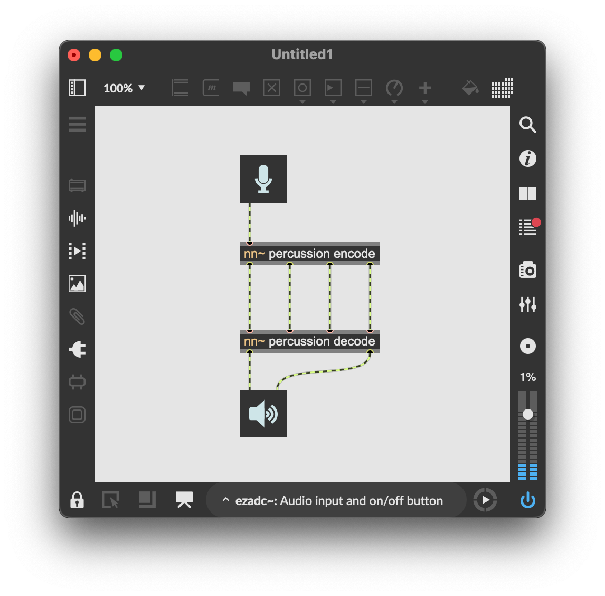
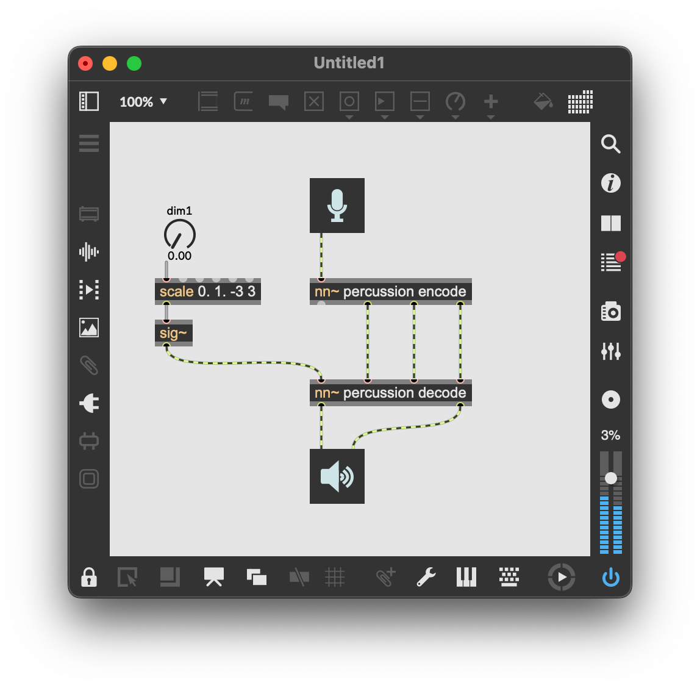
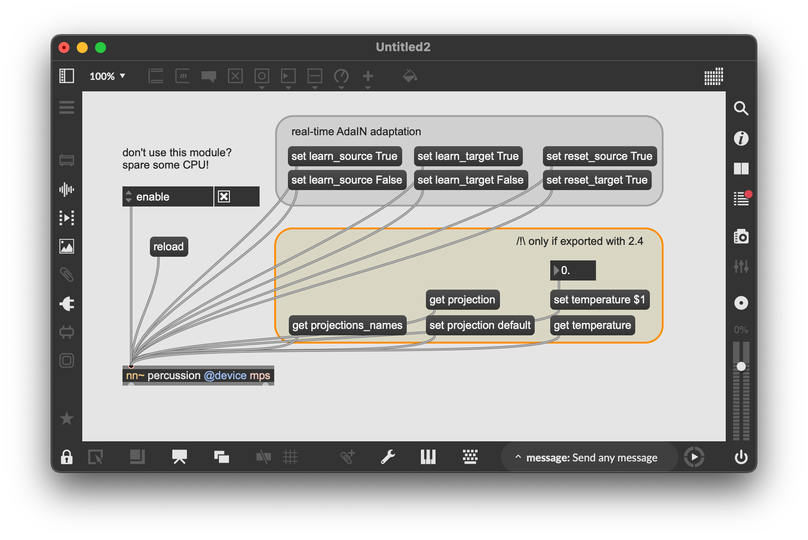

# RAVE: Realtime Audio Variational autoEncoder

Official implementation of _RAVE: A variational autoencoder for fast and high-quality neural audio synthesis_ ([article link](https://arxiv.org/abs/2111.05011)) by Antoine Caillon and Philippe Esling.

If you use RAVE as a part of a music performance or installation, be sure to cite either this repository or the article !

If you want to share / discuss / ask things about RAVE you can do so in our [discord server](https://discord.gg/abKp6t9jWY)!

Please check the FAQ before posting an issue!

**RAVE VST** RAVE VST for Windows, Mac and Linux is available as beta on the [corresponding Forum IRCAM webpage](https://forum.ircam.fr/projects/detail/rave-vst/). For problems, please write an issue here or [on the Forum IRCAM discussion page](https://discussion.forum.ircam.fr/c/rave-vst/651).

**Tutorials** : new tutorials are available on the Forum IRCAM webpage, and video versions are coming soon!

- [Tutorial: Neural Synthesis in a DAW with RAVE](https://forum.ircam.fr/article/detail/neural-synthesis-in-a-daw-with-rave/)
- [Tutorial: Neural Synthesis in Max 8 with RAVE](https://forum.ircam.fr/article/detail/tutorial-neural-synthesis-in-max-8-with-rave/)
- [Tutorial: Training RAVE models on custom data](https://forum.ircam.fr/article/detail/training-rave-models-on-custom-data/)

## Previous versions

The original implementation of the RAVE model can be restored using

```bash
git checkout v1
```

## Installation

**Warning** It is strongly advised to install `torch` and `torchaudio` before `acids-rave`, so you can choose the appropriate version of torch on the [library website](http://www.pytorch.org). You may also need **ffmpeg** and **sox** on your computer. You can install it locally inside your virtual environment using

```bash
conda install -c conda-forge torch==2.5.1 torchaudio==2.5.1 ffmpeg sox
```

To install RAVE, just use

```bash
pip install acids-rave
```

## Colab

A colab to train RAVEv2 is now available thanks to [hexorcismos](https://github.com/moiseshorta) !
[](https://colab.research.google.com/drive/1ih-gv1iHEZNuGhHPvCHrleLNXvooQMvI?usp=sharing)

## Usage

Training a RAVE model usually involves 3 separate steps, namely _dataset preparation_, _training_ and _export_.

### Dataset preparation

<!-- You can know prepare a dataset using two methods: regular and lazy. Lazy preprocessing allows RAVE to be trained directly on the raw files (i.e. mp3, ogg), without converting them first. **Warning**: lazy dataset loading will increase your CPU load by a large margin during training, especially on Windows. This can however be useful when training on large audio corpus which would not fit on a hard drive when uncompressed. In any case, prepare your dataset using -->

Before making a training, you will need to prepare the data. The v2.4 version leverages the [acids-dataset](https://github.com/acids-ircam/acids-dataset) library for data pre-processing, be sure to check the github to access all the feature's library. A shortcut is given for a direct use within `rave`:

```bash
rave preprocess --input_path /audio/folder --output_path /processed/path --channels X --device your_device
```

By default, audio files are splitted in chunks of 262144 samples, with a 50% overlap. Be careful then, don't be surprised if the pre-processed folder is larger than your original data.

### Training

After the dataset pre-processing, you can start training your RAVE model.

```bash
rave train --db_path /processed/path --out_path /model/out --name give_a_name --channels X
```

Several configurations are available, that you can give using the `--config` keyword (default is `v2`). For example, you can train a _discrete_ configuration, similar to SoundStream or EnCodec, by providing

```bash
rave train --config discrete ...
```

By default, RAVE is built with non-causal convolutions. If you want to make the model causal (hence lowering the overall latency of the model), you can use the causal mode

```bash
rave train --config v2 --config causal ...
```

Data augmentations are also available to improve the model's generalization in low data regimes. You can add data augmentations by adding augmentation configuration files with the `--augment` keyword :

```bash
rave train --config v2 --augment mute --augment compress
```

`.gin` files for augmentations are generated by the `acids-dataset` package providing transforms and linkage to [audiomentations](https://github.com/iver56/audiomentations), and aliased to `rave/configs/augmentations`.

Many other configuration files are available in `rave/configs` and can be combined. Here is a list of all the available configurations & augmentations :

<table>
<thead>
<tr>
<th>Type</th>
<th>Name</th>
<th>Description</th>
</tr>
</thead>
<tbody>

<tr>
<td rowspan=8>Architecture</td>
<td>v1</td>
<td>Original continuous model (minimum GPU memory : 8Go)</td>
</tr>

<tr>
<td>v2</td>
<td>Improved continuous model (faster, higher quality) (minimum GPU memory : 16Go)</td>
</tr>

<tr>
<td>v2_small</td>
<td>v2 with a smaller receptive field, adpated adversarial training, and noise generator, adapted for timbre transfer for stationary signals (minimum GPU memory : 8Go)</td>
</tr>

<tr>
<td>v2_nopqmf</td>
<td>(experimental) v2 without pqmf in generator (more efficient for bending purposes) (minimum GPU memory : 16Go)</td>
</tr>

<tr>
<td>v3</td>
<td>v2 with Snake activation, descript discriminator and Adaptive Instance Normalization for real style transfer (minimum GPU memory : 32Go)</td>
</tr>

<tr>
<td>discrete</td>
<td>Discrete model (similar to SoundStream or EnCodec) (minimum GPU memory : 18Go)</td>
</tr>

<tr>
<td>onnx</td>
<td>Noiseless v1 configuration for onnx usage (minimum GPU memory : 6Go)</td>
</tr>

<tr>
<td>raspberry</td>
<td>Lightweight configuration compatible with realtime RaspberryPi 4 inference (minimum GPU memory : 5Go)</td>
</tr>

<tr>
<td rowspan=3>Regularization (v2 only)</td>
<td>default</td>
<td>Variational Auto Encoder objective (ELBO)</td>
</tr>

<tr>
<td>wasserstein</td>
<td>Wasserstein Auto Encoder objective (MMD)</td>
</tr>

<tr>
<td>spherical</td>
<td>Spherical Auto Encoder objective</td>
</tr>

<tr>
<td rowspan=1>Discriminator</td>
<td>spectral_discriminator</td>
<td>Use the MultiScale discriminator from EnCodec.</td>
</tr>

<tr>
<td rowspan=5>Others</td>
<td>causal</td>
<td>Use causal convolutions</td>
</tr>

<tr>
<td>noise</td>
<td>Enables noise synthesizer V2</td>
</tr>

<tr>
<td>hybrid</td>
<td>Enable mel-spectrogram input</td>
</tr>

<tr>
<td>adv_at_start</td>
<td>Enables adversarial learning at start (Experimental)</td>
</tr>

<tr>
<td>no_encoder_freeze</td>
<td>Does not freeze the encoder at phase 2 (latent space is still trained)</td>
</tr>

</tbody>
</table>

### Export

Once trained, export your model to a torchscript file using

```bash
rave export --name export_name --run /path/to/your/run --out_path /out/path/for/scripted (--streaming)
```

Setting the `--streaming` flag will enable cached convolutions, making the model compatible with realtime processing. **If you forget to use the streaming mode and try to load the model in Max, you will hear clicking artifacts.**

### Fine-tune

Since v2.4, a specific function allow you to fine-tune a model from an existing checkpoint. The difference between fine-tuning and training is that generally you fine-tune on another dataset that the original training, and freeze / train only some parameters of the model. For example, training only the encoder (for example, a model trained on flute) with another dataset (for example, a model trained on voice) allows to increase the timbre transfer between flute and voice. For example :

```bash
rave finetune --name run_name --run /path/to/original/run --db_path /path/to/db --out_path /path/to/finetuned/model --train encoder
```

For the `train` keyword, you can either use specific words (`all`, `encoder`, `decoder`, `discriminator`), or a list of weights. For example :

```bash
rave finetune --name run_name --run /path/to/original/run --db_path /path/to/db --out_path /path/to/finetuned/model --train "decoder.net.[0-3].*"
```

will only fine-tune the three first layers of the decoder. To access all the keys, you can use Python :

```python
import rave

model, path = rave.load_rave_checkpoint("path/to/run")
print(model.state_dict().keys())
```

#### Fine-tuning modes

Fine-tuning imports the source run's configuration and weights and starts at
fine-tuning batch 0 with fresh optimizers. PCA updates are disabled by default.
Use `--mode` to choose the objective:

- `encoder` (default): update only the encoder using reconstruction and latent regularization
  losses, keeping the decoder fixed.
- `full`: update encoder and decoder using reconstruction, adversarial,
  feature-matching and latent regularization losses; update the discriminator
  using the source run's `update_discriminator_every` cadence. Discriminator
  batches update only the discriminator; other batches update encoder/decoder.
  The cadence uses completed fine-tuning batches, so it persists across epochs
  and checkpoint resume.
- `alternating`: on even batches (starting at 0), update decoder and discriminator
  using reconstruction and adversarial losses; on odd batches, update only the
  encoder using reconstruction and latent regularization. Feature matching is
  excluded in this mode.

The source configuration defines reconstruction losses, latent regularization,
and loss weights. For variational models, `--beta 0.01` overrides the encoder
beta imported from the source run; omitting it uses the source beta divided by 4. Beta
must be finite and nonnegative, and `--beta 0` disables KL regularization. The
effective KL coefficient also includes any configured regularization loss weight.
Resume with the same beta.
`--train` and `--freeze` further restrict parameter selection.
Frozen modules run in evaluation mode; gradients can still pass through the
fixed decoder to the encoder.

```bash
rave finetune --name adaptation --run /path/to/source/run --db_path /path/to/db \
  --mode alternating --lr_encoder 1e-5 --lr_decoder 1e-4 \
  --lr_discriminator 1e-4 --encoder_start_step 10000 --max_steps 50000
```

`--encoder_start_step` counts completed fine-tuning batches. Before this threshold,
encoder parameters stay fixed; in alternating mode they start on the next encoder
turn. The default is 0. `--max_steps` is the total target number of fine-tuning
batches, including previously completed batches when resuming. Lightning's
`global_step` may be higher because a batch can update two optimizers.

Use `--ckpt /path/to/finetuning.ckpt` to resume optimizers, batch count and
alternating phase. Supply the same mode, learning rates, encoder delay and
regularization setting when resuming. Use `--run` alone to initialize from source
weights. `--override` applies Gin bindings to the imported source configuration.

#### Note: since v2.4, this argument defaults to True.

## Prior

For discrete models, we redirect the user to the `msprior` library [here](https://github.com/caillonantoine/msprior). However, as this library is still experimental, the prior from version 1.x has been re-integrated in v2.3.

### Training

To train a prior for a pretrained RAVE model :

```bash
rave train_prior --model /path/to/your/run --db_path /path/to/your_preprocessed_data --out_path /path/to/output
```

this will train a prior over the latent of the pretrained model `path/to/your/run`, and save the model and tensorboard logs to folder `/path/to/output`.

### Scripting

To script a prior along with a RAVE model, export your model by providing the `--prior` keyword to your pretrained prior :

```bash
rave export --run /path/to/your/run --prior /path/to/your/prior (--streaming)
```

## Pretrained models

Several pretrained streaming models [are available here](https://acids-ircam.github.io/rave_models_download). We'll keep the list updated with new models.

## Realtime usage

This section presents how RAVE can be loaded inside [`nn~`](https://acids-ircam.github.io/nn_tilde/) in order to be used live with Max/MSP or PureData.

### Reconstruction

A pretrained RAVE model named `darbouka.gin` available on your computer can be loaded inside `nn~` using the following syntax, where the default method is set to forward (i.e. encode then decode)


This does the same thing as the following patch, but slightly faster.



### High-level manipulation

Having an explicit access to the latent representation yielded by RAVE allows us to interact with the representation using Max/MSP or PureData signal processing tools:



### Style transfer

By default, RAVE can be used as a style transfer tool, based on the large compression ratio of the model. We recently added a technique inspired from StyleGAN to include Adaptive Instance Normalization to the reconstruction process, effectively allowing to define _source_ and _target_ styles directly inside Max/MSP or PureData, using the attribute system of `nn~`.



Other attributes, such as `enable` or `gpu` can enable/disable computation, or use the gpu to speed up things (still experimental).

## Offline usage

A batch generation script has been released in v2.3 to allow transformation of large amount of files

```bash
rave generate --model model_path --input path_1 --input path_2 --out out_path
```

where `model_path` is the path to your trained model (original or scripted), `path_X` a list of audio files or directories, and `out_path` the out directory of the generations.

## Discussion

If you have questions, want to share your experience with RAVE or share musical pieces done with the model, you can use the [Discussion tab](https://github.com/acids-ircam/RAVE/discussions) !

## Demonstration

### RAVE x nn~

Demonstration of what you can do with RAVE and the nn~ external for maxmsp !

[](https://www.youtube.com/watch?v=dMZs04TzxUI)

### embedded RAVE

Using nn~ for puredata, RAVE can be used in realtime on embedded platforms !

[](https://www.youtube.com/watch?v=jAIRf4nGgYI)

# Frequently Asked Question (FAQ)

**Question** : my preprocessing is stuck, showing `0it[00:00, ?it/s]`<br/>
**Answer** : This means that the audio files in your dataset are too short to provide a sufficient temporal scope to RAVE. Try decreasing the signal window with the `--num_signal XXX(samples)` with `preprocess`, without forgetting afterwards to add the `--n_signal XXX(samples)` with `train`

**Question** : During training I got an exception resembling `ValueError: n_components=128 must be between 0 and min(n_samples, n_features)=64 with svd_solver='full'`<br/>
**Answer** : This means that your dataset does not have enough data batches to compute the intern latent PCA, that requires at least 128 examples (then batches).

# Funding

This work is led at IRCAM, and has been funded by the following projects

- [ANR MakiMono](https://acids.ircam.fr/course/makimono/)
- [ACTOR](https://www.actorproject.org/)
- [DAFNE+](https://dafneplus.eu/) N° 101061548


