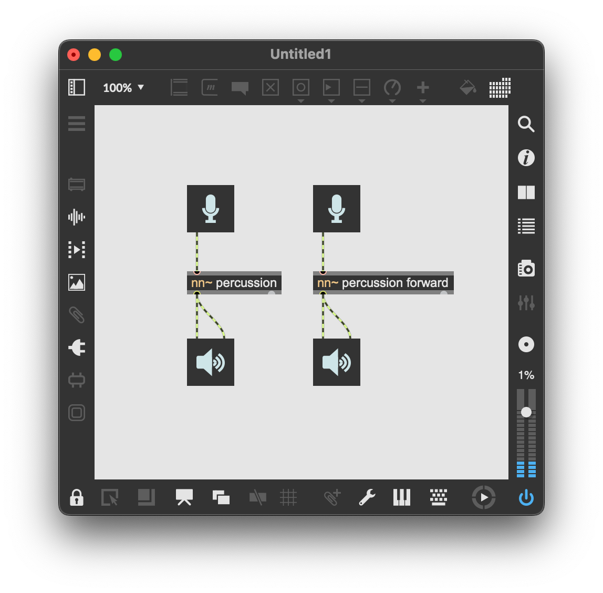
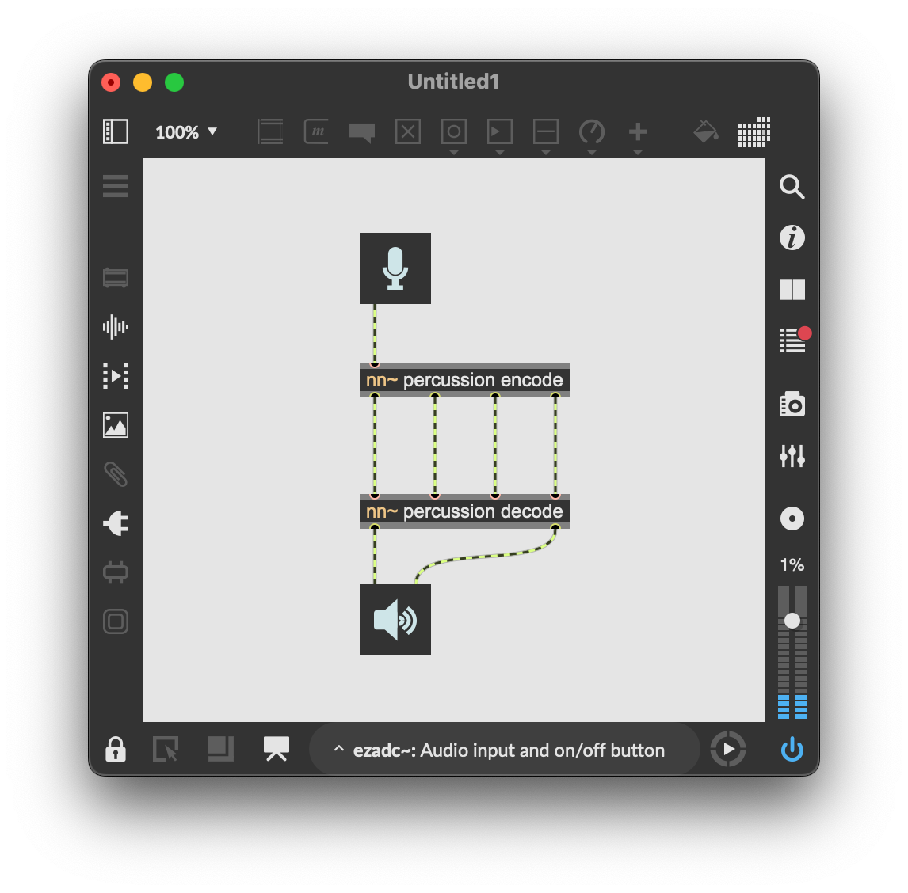
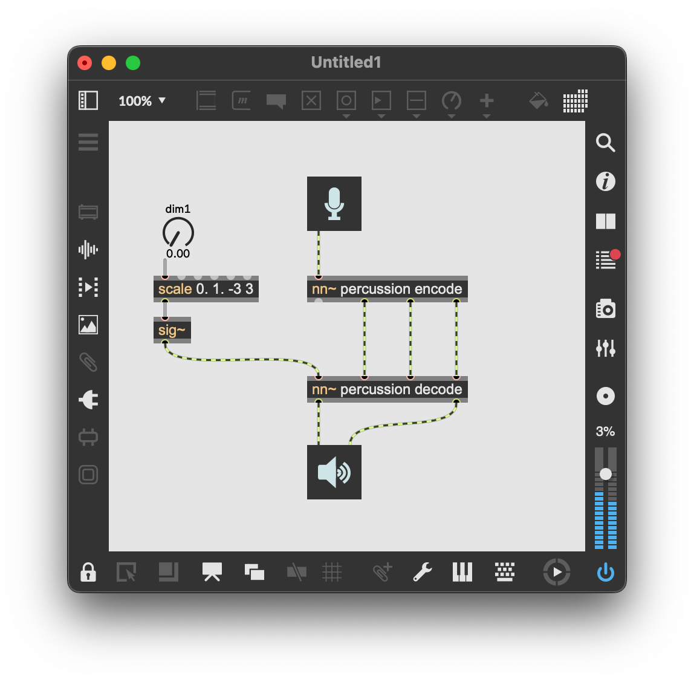
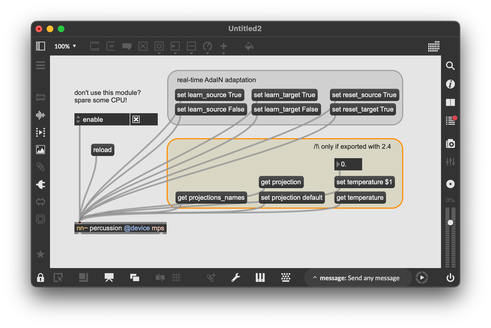

# Tutorial 1 — Use a RAVE model in Max/MSP

In this tutorial you load a pretrained RAVE model in Max, resynthesize a live input through it,
and then play with its latent space directly.

**You need:** Max 8 or later, the [`nn~`](https://acids-ircam.github.io/nn_tilde/) package, and a
*streaming* RAVE model (`.ts`). No Python and no GPU are needed.

> Pure Data works the same way with the Pd version of `nn~`; only the object boxes differ.

## 1. Install `nn~`

1. Download the latest `nn~` release for your platform from the
   [nn_tilde releases page](https://github.com/acids-ircam/nn_tilde/releases) (or install it from
   Max's Package Manager when available).
2. Unzip it into `~/Documents/Max 8/Packages/` (or `Max 9/Packages`).
3. Restart Max. Typing `nn~` in an object box should now create an object (it will complain that no
   model is given — that is fine).

On macOS, if Max refuses to load the external, remove the quarantine flag:

```bash
xattr -r -d com.apple.quarantine ~/Documents/Max\ 8/Packages/nn_tilde
```

## 2. Get a model

- **Pretrained models:** download one from the
  [RAVE models page](https://acids-ircam.github.io/rave_models_download).
- **Your own model:** export it with the `--streaming` flag (see
  [Tutorial 3](03_export_max.md)):

  ```bash
  rave export --run runs/my_model_abc123 --streaming
  ```

  This writes `my_model_abc123_streaming.ts`. A model exported **without** `--streaming` will
  produce clicks in Max.

Put the `.ts` file in a folder of Max's search path — the simplest is the folder of your patch, or
`nn_tilde/models/` inside the package. You can then refer to it by name without the extension.

## 3. Resynthesis: `forward`

Create this patch:

```text
[ezadc~]          ← or [sfplay~] / [groove~] playing a sound file
 |
[nn~ darbouka forward]
 |
[ezdac~]
```

`nn~ <model> <method>` loads `<model>.ts` and runs `<method>`; `forward` encodes and decodes.
Turn the DSP on: your input is now rebuilt by the model, *in the timbre of its training data*. A
voice going through a violin model comes out as a violin following the voice's dynamics and
pitch contour — this is the classic RAVE *timbre transfer*.



Tips:

- An optional third argument sets the internal buffer size, e.g. `[nn~ darbouka forward 4096]`.
  Larger buffers lower the CPU load and raise the latency. If you hear dropouts, increase it.
- The model runs at its own sampling rate (usually 44.1 kHz). Run Max at the same rate, or export
  the model with `--sr 48000`-style resampling if it is a multiple.
- Send `enable 0` / `enable 1` to bypass computation, and `gpu 1` to try GPU inference.

## 4. Encode, then decode

`forward` is equivalent to an `encode` followed by a `decode`:

```text
[ezadc~]
 |
[nn~ darbouka encode]       ← one outlet per latent dimension
 |  |  |  |  ...
[nn~ darbouka decode]       ← one inlet per latent dimension
 |
[ezdac~]
```



Each outlet of `encode` is a **latent signal**, running much slower than audio (one value every
2048 samples for a `v2` model, i.e. ~21 Hz at 44.1 kHz). By default the latent dimensions are sorted
by importance (PCA): the first ones control the most salient aspects of the sound (often loudness
and brightness), the last ones finer details.

Multichannel version: `mcs.nn~` packs all latent dimensions into a single multichannel cable,
which is much easier to patch when the latent space is large:

```text
[mcs.nn~ darbouka encode]
 |
[mc.*~ 1.]        ← process all dimensions at once
 |
[mcs.nn~ darbouka decode]
```

## 5. Play with the latent space

Insert processing between `encode` and `decode`:

```text
[nn~ darbouka encode]
 |          |
[+~ 0.]    [*~ 1.]          ← offset / scale individual dimensions
 |          |
[nn~ darbouka decode]
```



Things to try:

- **Bias** a dimension with `[+~]` (values between −3 and 3 are a reasonable range): shifts the
  timbre in a consistent direction.
- **Scale** a dimension with `[*~]`: exaggerate (`> 1`) or flatten (`< 1`) its variations.
- **Freeze** a dimension with `[sah~]` or by replacing it with a constant `[sig~ 0.]`.
- **Generate** without input: drive `decode` with LFOs (`[cycle~ 0.2]`), noise (`[noise~]` through
  a low-pass filter), or envelopes. You get sounds that only exist in the model.
- **Morph** between two sounds: encode two sources with two `nn~ encode` objects and crossfade
  their latent signals before a single `decode`.

## 6. Attributes

Attributes change the model's behaviour at runtime. Send them as messages to any `nn~` object
using that model:

| Message                     | Effect |
| --------------------------- | ------ |
| `set temperature $1`        | Amount of randomness. `0` = deterministic. Also scales the noise used for latent dimensions that `decode` does not receive. |
| `set projection pca_myname` | Switch the latent coordinate system (see [Tutorial 5](05_custom_representations.md)). `default` = PCA, `raw` = raw latent space. |
| `set learn_target 1` / `0`  | (`v3` / AdaIN models) Learn the style of the incoming sound as the *target* style... |
| `set learn_source 1` / `0`  | ...or as the *source* style. |
| `set reset_target 1`        | Forget the learned style. |

The read-only attribute `projection_names` lists the available projections, separated by `|`
(you can also print them with `rave dimred show --model my_model.ts`).



With AdaIN models (`v3`), the typical style-transfer workflow is: play the reference style with
`learn_target 1`, switch it off, then play your source sound — its statistics are mapped to the
reference's.

## 7. Prior: generation from nothing

If the model was exported with a prior (`rave export --prior ...`, see [Tutorial 6](06_prior.md)),
a `prior` method is available. Its input controls the sampling temperature (`0` = temperature 1,
negative = more conservative, positive = wilder); its outputs are latent trajectories to send to
`decode`:

```text
[sig~ 0.]                      ← temperature control
 |
[nn~ darbouka prior]
 |  |  |  ...
[nn~ darbouka decode]
 |
[ezdac~]
```

## Troubleshooting

| Symptom | Fix |
| ------- | --- |
| Clicks / crackles | The model was not exported with `--streaming`; re-export it. Or increase the buffer size. |
| `nn~` cannot find the model | Put the `.ts` next to your patch or in the Max search path, or give its full path. |
| Very high CPU usage | Increase the buffer size, use a smaller model (`v2_small`, `raspberry`), or a `causal` one. |
| Silence with `decode` only | Latent inputs at 0 are a valid but often quiet point; add offsets or LFOs, or raise `temperature`. |
| Pitch / speed is wrong | Max's sampling rate differs from the model's. |
